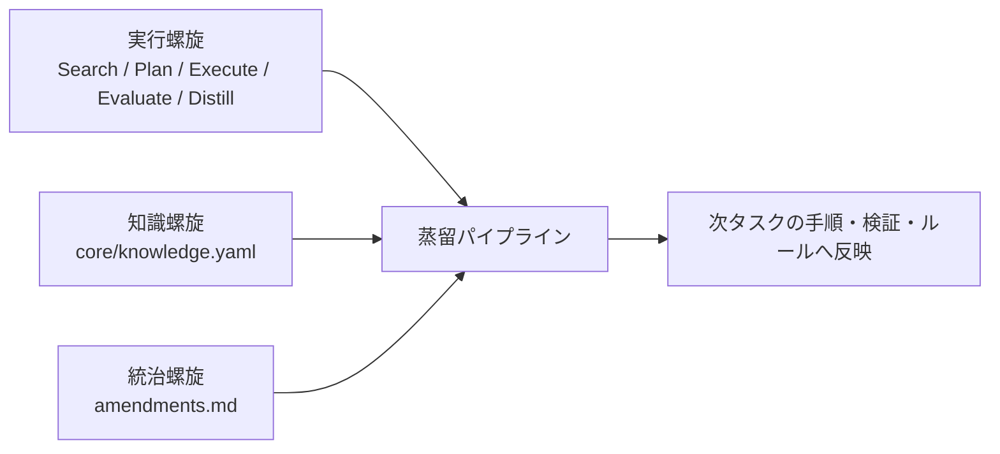
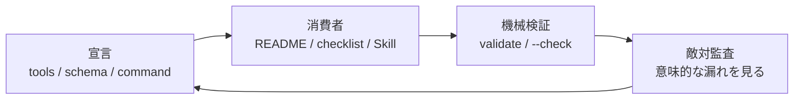
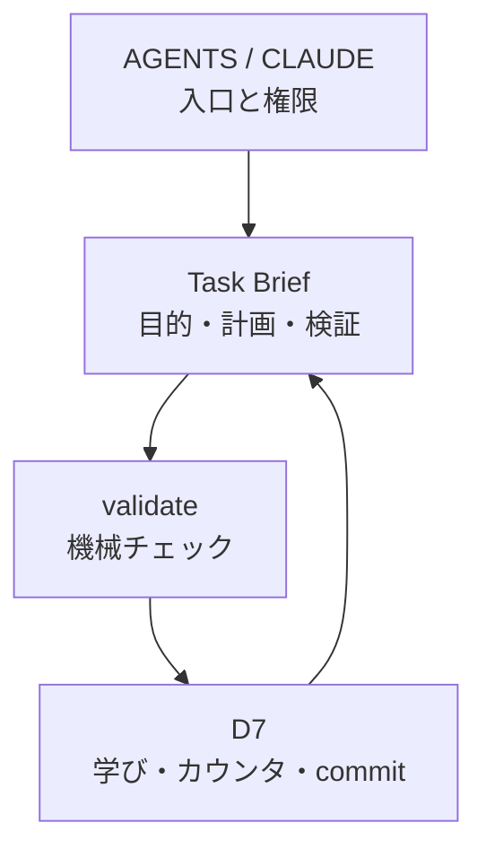

# HyperHelix — AI エージェントに「開発プロセス」を内側から適用したフレームワーク

<!-- Qiita タグ候補: AI, LLM, Claude, エージェント, プロンプトエンジニアリング, フレームワーク設計, ClaudeCode -->
<!-- 冒頭140字案: AI エージェント用プロンプトを、憲法・変更管理・lint・レビュー対象として育てる。HyperHelix は、プロセス改善そのものを CI/CD するための実験的フレームワークです。 -->

---

## はじめに

AI エージェントに仕事を頼むとき、ほとんどのフレームワークは「いいプロンプトを書いて AI をブラックボックスとして使い回す」設計です。

**HyperHelix** は逆の発想を取ります。

> AI が使うフレームワーク自体を、ソフトウェアエンジニアリングの開発プロセス（PR・ゲート・lint・変更管理）で管理する。

フレームワークが CI/CD の対象になる、という少し変わったアーキテクチャです。

---

## 全体像：三重螺旋

名前の由来でもある「3本の螺旋が1本のパイプラインを共有する」構造が核心です。

```
実行螺旋  ────────────────────────────┐
                                      ├── 蒸留パイプライン ──→ フレームワーク改善
知識螺旋  ──[ノート蓄積]──────────────┤
                                      │
統治螺旋  ──[人間承認 amendments.md]──┘
```

| 螺旋 | 役割 | 権威ファイル |
|------|------|------------|
| 実行 | 全タスクを 5 フェーズで実行 | `core/loop.yaml` |
| 知識 | 経験をノートとして蒸留・蓄積 | `core/knowledge.yaml` |
| 統治 | 高影響変更だけ人間が単一窓口で裁可 | `amendments.md` |



---

## 5 フェーズループ

すべてのタスクは例外なく次の 5 フェーズを通ります（深度モードで工程は縮小するが、フェーズは削除しない）。

```
Search → Plan → Execute → Evaluate → Distill
  S1-S4    P1-P6    E1-E4     V1-V3      D1-D7
```

フェーズごとに **成果物(artifact)** を定義し、次フェーズへの入力とする設計は、ソフトウェアの CI パイプラインそのものです。

---

## ユニークな設計判断 6 選

### 1. 「ミスはプロセスの問題」を憲法に刻む

```markdown
# constitution.md（抜粋）
ミスは実行者ではなくプロセスの問題として扱う。改善対象は常にプロセスである。
```

失敗のたびに AI のキャラクターを調整するのではなく、**手続き（プロセス）を改訂する**方向に向かいます。これが「螺旋が回る」ことの意味です。

---

### 2. amendments.md — 憲法改正プロセスの単一窓口

高影響変更（新しいルールの追加・ゲートパラメータ変更・大規模統廃合）だけを `amendments.md` に集約し、必ず人間承認を経由します。

承認の証跡には `ratified_by` / `ratified_at` フィールドを付与します（HH-042）。これにより「AI が自己承認した」か「人間が承認した」かが視覚的・機械的に区別できます。

```markdown
## HH-042 — 承認ゲートの技術的可視化

**Status:** Approved(2026-06-24 ユーザー承認)
**ratified_by:** COCOQ-gh
**ratified_at:** 2026-06-24
**種別:** 運用規約・統治変更
```

validate コマンドが **`AMEND_RATIFIED_BY_EMPTY` チェック**を自動実行し、`ratified_by` 欄が空の Approved エントリを警告します。

この設計の動機は、「AI に絶対に自己承認させない技術的な鍵」を作れたからではありません。むしろ逆で、AI がリポジトリに書き込める限り、承認フィールドは技術的には偽造可能です。だから HyperHelix はこれを **self-attested approval** と呼び、強制ではなく監査可能性を上げる仕組みとして扱います。脆弱性を隠さず、可視化できるところから機械チェックへ寄せていく、という方針です。

---

### 3. AP-003「宣言↔消費」クロスリファレンス公理

HyperHelix で最も繰り返し問題になったのが「新機能を追加したが、それを参照する側（checklist / template / schema）を更新し忘れる」という漏れです。

これを **AP-003 anti-pattern** として定義し、3 層で防止しています：

```
L1: machine validators（validate コマンドに自動検出ロジックを追加）
L2: Plan フェーズの P6 ゲート（能力追加時は同一変更リストで消費側を必須配線）
L3: post-merge Codex 敵対的監査（機械が捕えない意味的漏れを人間+AI で発見）
```

たとえば、ツールに新しいサブコマンドを追加しても、README や評価チェックリストや補完用 Skill に反映されなければ、実際の運用者はその機能に気づけません。HyperHelix では、そうした「宣言したが消費者がいない」状態を AP-003 として扱います。

最近の改善では、`update-codex-skill --check` を追加しただけでなく、README と evaluate checklist も同じ変更で更新しました。機能を足した瞬間に、その機能を呼ぶ人間・AI・検証器の経路まで同時に配線する、という考え方です。



---

### 4. cost-report + R7 ／ consolidation-report + R8 の対称設計と収束指標

フレームワーク自身の「コスト」と「冗長性」を定期測定するための 2 本の計測ツールを持ちます。

```
node tools/hyperhelix.mjs cost-report          # 常時必読資材の行数・複雑度測定
node tools/hyperhelix.mjs consolidation-report # 冗長クラスタ・lifecycle drift 測定
```

さらに、**収束指標**として前回 `/cycle` 比のトレンド差分を自動記録します。

```
R7a: 常時必読 452行  [直近ベースライン]     ← cost-report が knowledge.yaml に自動記録
R8c: process-backlog 18件 [直近ベースライン] ← consolidation-report が記録
```

`▲` が続くなら肥大化シグナル、`▼` が続くなら焼却進行中という判断ができます。**改善行為そのものが肥大化する問題を、フレームワーク内部のレンズで収束値として捕捉する**構造です。

---

### 5. 自己目的化の公理と R6 enforcement

```markdown
# constitution.md（抜粋）
改善サイクルは成果物を作るために存在する。
フレームワークのみを対象とするサイクルが 3 回続いたら、次は実タスクを優先する。
改善活動が自己目的化したら、それ自体を改善対象とする。
```

AI エージェントが自分のプロンプト最適化に閉じることへの **制度的ブレーキ**です。

さらにブランチ意味論と組み合わせています：

| ブランチ | R6 enforcement | 意味 |
|---------|---------------|------|
| `main` | STOPPED | フレームワーク開発が本来の目的。人間が判断 |
| `project/*` | ACTIVE | 実プロジェクト作業が期待されるため監視する |

ただし、ここで一度設計ミスが起きました。R7d という「敵対的類推」レンズは、本来は「この設計を却下する競合フレームは何か」を問うためのものでした。ところが運用中に、実プロジェクト未適用・ROI 未実証を指摘するレンズとしても使われ、2つの役割が混ざりました。

その結果、ROI 側の誤検知を避けるために R7d 全体を `main` で停止したところ、同時に「より単純な設計はないか」と問うフレーム却下機能まで止まってしまいました。HH-056 はこの混線を分割し、ROI は外部価値ゲートへ委譲しつつ、フレーム却下レンズだけを復活させる提案です。HyperHelix では、こうした「よいチェックを束ねすぎて片方の問題で全体が死ぬ」失敗も、プロセスの改善対象になります。

---

### 6. AI エージェントリスクへの設計的対応

「賢い AI に頼む」だけでは解決できない問題があります。HyperHelix のセキュリティ評価で特定したリスクと、フレームワークの対応状況を整理します。

| リスク | 対策 | 対策の強さ |
|--------|------|-----------|
| 認証情報の漏洩 | HH-019/020：コミット前の secret scan 必須、AI は生値を扱わない | **強** |
| 破壊的操作 | git 可逆性 + 人間ゲート | **中** |
| 自己承認（AI がルール変更を自己裁可） | amendments.md の `ratified_by` フィールド + validate 警告 | **中**（可視化止まり） |
| プロンプトインジェクション | search.md S4 に警戒ライン追加（外部ファイル読取時の指示様テキスト検出） | **中** |
| 自律暴走（自己目的化） | R6 + 憲法 axiom-5（honour-based） | **中** |
| 監査可能性 | git 履歴 + task brief が全記録 | **強** |

重要なのは「最大のガバナンス脆弱性が honor-based（AI の遵守が前提）である」という現実を正直に認識していることです。技術的強制より「可視性の向上」を優先し、後続の validate ルールで徐々に機械的な防衛線を追加していく設計思想です。

---

## 知識管理の設計思想

`core/knowledge.yaml` にフラットなノート台帳を持ちます。

```yaml
- id: N-041
  project: shared
  tags: [cross-reference, AP-003, validation]
  strength: 5
  state: active
  text: "宣言↔消費の整合は機械チェック(L1)＋P6ゲート(L2)＋敵対監査(L3)の3層で守る。..."
```

ポイントは **自動昇格・降格を廃止**（HH-016）したこと。`strength` は検索順位のヒントに過ぎず、ルールへの昇華は人間が手動で判断します。「AI が自分でルールを書き換える」というリスクを意図的に排除しています。

---

## 機械バリデーターの実装例

```javascript
// tools/hyperhelix.mjs（抜粋）

// Approved な HH エントリに ratified_by が空なら警告（HH-042）
function validateAmendRatifiedBy() {
  const logSection = text.slice(text.indexOf("## 承認済みログ"));
  for (const entry of parseHHEntries(logSection)) {
    if (!entry.isApproved) continue;
    if (!entry.ratifiedBy || entry.ratifiedBy.startsWith("(")) {
      issues.push(warn("AMEND_RATIFIED_BY_EMPTY",
        `${entry.id} is Approved but ratified_by is empty`));
    }
  }
}

// validate の各チェックコードが framework-review R1 に列挙されているか
function validateCheckDoc() {
  for (const code of allCheckCodes) {
    if (!reviewContent.includes(code)) {
      issues.push(warn("CHECK_DOC_CONSISTENCY",
        `guard '${code}' is not listed in R1`));
    }
  }
}
```

「フレームワークの記述とコードの実装が乖離する」という AP-003 型の漏れを、ツールが自動検出します。さらに validate 自身の健全性（チェックコードの列挙漏れ）も validate が検出するというメタ構造を持っています。

---

## 実際の改善サイクル（/cycle）の流れ

```
/cycle を実行
  → R1: 資材整合チェック（validate 0 error 確認）
  → R2: スキーマ整合
  → R3: 機械バリデーター実行
  → R4: 使いやすさ評価
  → R5: AI 資材のフィット確認
  → R6: 自己目的化チェック（main は STOPPED）
  → R7: cost-report でコスト測定（前回比トレンド差分を自動記録）
  → R8: consolidation-report で冗長測定（backlog 焼却トレンドを自動記録）
  → 発見 → process-backlog へ class タグ付きで起票
  → 次の /cycle で焼却（burn-down）
```

---

## まとめ：何が新しいか

| 一般的な AI フレームワーク | HyperHelix |
|--------------------------|-----------|
| AI をブラックボックスとして使う | フレームワーク自体を CI/CD 対象にする |
| エラー → 再試行 | エラー → プロセス改訂 |
| プロンプトが権威 | 憲法 + amendments.md が権威 |
| 知識は文脈に埋め込む | 知識はフラット台帳で蓄積・人間が昇華 |
| 改善は無制限 | 自己目的化を公理で制度的に防止 |
| コスト無計測 | cost-report + consolidation-report で収束トレンドを定量化 |
| セキュリティは AI 任せ | ratified_by 証跡 + secret scan + プロンプトインジェクション警戒 |

---

## 自分のプロジェクトで使うなら

HyperHelix 全体を最初から持ち込む必要はありません。最小構成なら、次の4つだけでかなり効きます。

1. `AGENTS.md` / `CLAUDE.md` に入口を書く  
   AI が最初に読む順序と、編集してよい範囲を固定します。

2. `validate` に相当する機械チェックを置く  
   ルール・テンプレート・コマンド・ドキュメントの食い違いを、完了前に落とします。

3. タスクブリーフを1枚だけ残す  
   目的、受入条件、変更リスト、検証結果、学びを短く記録します。長い日報ではなく、次の AI が使うための証跡です。

4. D7 的な最後の処理を固定する  
   「検証した」「学びを残した」「コミットした」を、毎回同じ順で閉じます。



この最小版でも、AI への依頼は「チャットの流れ」から「レビュー可能な変更」に変わります。最初の狙いは、完璧な自動統治ではなく、次の失敗を少し見つけやすくすることです。

---

## おわりに

HyperHelix は「AI が賢くなれば解決する」方向ではなく、「プロセスを正しく設計すれば AI の限界を補える」方向に賭けています。

ソフトウェアエンジニアリングで 50 年かけて培ってきた開発プロセスの知恵（ゲート・変更管理・CI・lint・コードレビュー）を、AI エージェントの内側にそのまま持ち込む試みです。

そして見えてきた現実は「**プロセスの強度は技術的強制ではなく、今もなお honor-based の部分が大きい**」ということ。それ自体をフレームワークが正直に認識し、validate ルールで一つずつ機械的な防衛線に変えていく――その継続的な努力こそが HyperHelix の本質かもしれません。

---

<!-- 編集メモ / 残りタスク -->
<!--
[DRAFT NOTE - 2026-07-05 更新]
現状: HyperHelix の概要記事として本文骨格 + 具体例 + 最小導入ガイドまで成立。公開直前に可変数値だけ再確認する。

## 残りタスク
- [x] 冒頭 140 文字を作る。
- [x] AP-003 の具体例を1つ足す。
- [x] R7d / HH-056 の具体例を1つ足す。
- [x] ratified_by 導入の動機を補う。
- [x] 「自分のプロジェクトでどう使うか」セクションを追加。
- [x] 図解を追加: 三重螺旋、宣言↔消費の3層防御、最小導入ループ。
- [ ] 数値を公開直前に再確認: task_index / HH 件数 / process-backlog / 常時必読コスト / validate 結果。
- [x] 古い内部語や固有セッション依存表現を削る。
- [x] タグ・タイトル・サムネイル案を決める。

## 公開メタ案
- タイトル案: 「AI エージェント用プロンプトを CI/CD する: HyperHelix という実験」
- サブタイトル案: 「憲法、変更管理、lint、レビューで AI の開発プロセスを内側から育てる」
- タグ案: AI, LLM, エージェント, ClaudeCode, プロンプトエンジニアリング
- サムネイル案: 三重螺旋 + validate gate + human approval の3要素を1枚にまとめる。

## 文字数・構成メモ
- 現状: 骨格 + 主要論点 + 具体例 + 最小導入（約 5,000 字級）
- 目安: Qiita で読まれる技術記事は 3,000〜6,000 字
- セクション 6（セキュリティ）は新規追加。ユニークな切り口になる可能性が高い
- 「honor-based のガバナンスを自認しつつ機械化を積み上げる」という誠実さが差別化ポイント

## 最新の状態（2026-07-05 時点）
- task_index: 503 / HH 総数: 057 件(HH-000〜HH-056、HH-056 は Pending)
- process-backlog open: 18 件
- 常時必読コスト: 452 行
- validate: 0 error / 0 warning
- 直近の主要追加: HH-055 compaction-recovery hooks、HH-056 R7d 分割 Pending、brief 採番の git log 走査、Codex Skill 更新チェック
-->
