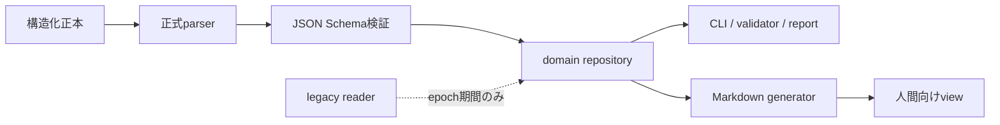

# HyperHelix 構造化正本移行計画

- **策定日:** 2026-07-17
- **状態:** 実装完了(SC-00〜08 全 package、2026-07-18。完了記録は末尾)
- **計画タスク:** `TASK-main-20260717-001`
- **上位決定:** HH-066 / `TASK-20260717-002`
- **実装基線:** 次回のリモート統合完了後の `main` HEAD

## 位置づけ

本計画は、FI-01〜06で導入した共有ID契約、Contract Change Gate、L1〜L4検証を基盤に、
「文章を正本として正規表現で構造・状態を推測する」方式の規模限界を解消する後続計画である。

本計画が解消する対象は**正規表現そのもの**ではない。IDやCLI入力の字句検証、秘密scan、
競合marker検出のようなテキストscanには正規表現を使える。禁止するのは、Markdownの見出し・表・
自由記述やYAMLの行配置から、実行に使うrecord・state・schemaを抽出することである。

### 既存計画との関係

- FI-01〜06は完了済みであり、本計画はそれらを置換しない。
- `TASK-20260717-002` とレビュー補助資料は監査履歴として変更しない。
- 既存FI-07bの「knowledge project別分割」は本計画SC-05の入力へ読み替える。
- SC-01の外部dependency導入(`yaml`+Ajv)は、FI-01の「外部dependencyは増やさない」方針の
  明示的転換であり、SC-00の裁可論点に含める。
- FI-07cはSC-05c完了を新しい依存条件とする。
- FI-08は残るFI-07系列に加えてSC-08完了を依存条件とする。

### リモート統合境界

- 本計画の資料化タスクではremote commitをmerge/pushしない。
- 次回作業の先頭で、ユーザー方針どおりremote 3 commitを統合する。
- remote 3 commitはlocalと別内容の`TASK-20260717-002`/`TASK-20260717-003`を名乗るため、
  統合時にtask ID二重割当と`tasks/` briefのadd/add衝突が確定している。HH-065の規約どおり
  footprintの小さい側(remote側brief)を同一transactionで再採番して解消する。
- `tools/hyperhelix.mjs`(local FI-01〜06改修 × remote multi-file parser)と`core/knowledge.yaml`は
  両側変更のためmerge衝突を手動解決し、双方の意味変更を保持する。
- remoteの分割実装はHH-045(2)として実施された**FI-07b相当の部分実装**である(knowledge.yamlの
  counters/schema/manifestへの縮小と「単一active file 300行以下」は未達。以下「remote分割」)。
  実現済みのファイル分割とnote配置は保持する。
- remote側の行regex parserは移行入力であり、SC-05cまで残るlegacy実装として扱う。
- remote統合後にvalidate、Node tests、L1〜L4、post-merge cross-reference auditを通し、
  そのgreen HEADをSC-00以降の基線にする。

## 現状と根本原因

| 領域 | 現状 | 規模限界 |
|---|---|---|
| 契約 | `core/contracts.json`はID、epoch、一部lifecycleを保持 | path class、evidence列、固定語彙がJS定数にも残る |
| Core YAML | `schema_version`、phase/artifact、gate値を行regexで抽出 | key順、複数行値、comment、schema拡張に弱い |
| Knowledge | note blockを独自行parserでobject化 | multi-file化に比例してparser分岐と重複scanが増える |
| Task brief | HTML anchorとMarkdown表を独自parserで検査 | escaped pipe、列追加、表示変更がoperation stateへ波及する |
| Amendments | heading位置と本文中Statusをregexで判定 | heading欠落はFI-06/RT-18でfail-closed化済みだが、機構自体が表示構造依存のまま残る |
| Framework evidence | header/path classをJS内に重複定義 | contract正本とruntimeの二重管理になる |

FI-01〜06は「契約値を共有し、完了経路へ検査を接続する」基盤を作った。しかし、値を置く場所を
共有しても、文章からrecordを復元する構造が残れば、項目数・ファイル数・project数の増加に伴って
parserと例外規則が増え続ける。根本原因はregexの精度ではなく、**表示形式と実行状態の未分離**である。

## 目標アーキテクチャ

### 設計原則

1. **実行事実は構造化正本:** ID、enum、path class、evidence schema、task state、note、HH lifecycleは構造化データを正本とする。
2. **文章はintent・理由・生成view:** 自由記述を機械処理の入力にしない。機械が必要な値は文章へ重複記載しない。
3. **正式parser + schema:** YAMLは`yaml` packageで解析し、Ajv strict modeのJSON Schemaで検証する。type coercionは無効とする。
4. **domain repository経由:** 正本ファイルのread/writeはdomain別repository APIに限定し、consumerはfilesystemや文字列形式を知らない。
5. **dual-read / single-write:** 移行中は旧形式を読めるが、新規writeは新正本だけに行う。dual-writeは禁止する。
6. **生成物は全文比較:** Markdown/docsはdeterministicに生成し、`--check`は期待全文とのbyte差分で判定する。
7. **fail-closed:** parser/schema/manifest/epochが不明ならskipせずnonzeroで停止する。
8. **1 task = 1 commit:** 各packageは単独検証・単独revert可能にする。

### 正本マトリクス

| domain | 構造化正本 | 人間向けview | runtime consumer | legacy扱い |
|---|---|---|---|---|
| ID・enum・path・evidence | `core/contracts.json` + JSON Schema | `docs/generated/contracts.md` | `tools/lib/contracts.mjs` | consumer直書きliteralはSC-07で禁止 |
| loop/routing/gates | 現行YAMLを正式parserでobject化 | 現行YAML（同一ファイル） | `core-model` repository | line regex readerをSC-02で撤去 |
| task record | `tasks/records/<TASK-ID>.yaml` | schema v2はon-demand Markdown、schema v1のみtracked generated view | brief/finish/verify repository | v1 pairとepoch前briefはread/archive互換 |
| governance | `governance/amendments/registry.yaml` + HH別body | `amendments.md`生成index/digest | HH allocator/lifecycle repository | 現憲法の変更をSC-00で人間裁可 |
| knowledge | manifest + `core/knowledge/<project>.yaml` | YAML自体 + 検索出力 | knowledge repository | remote分割形式(FI-07b相当)を移行入力にする |
| generated docs | 各構造化正本 | Markdown | generatorのみ | 手編集禁止、byte driftでfail |

### 実行時の境界



consumerが参照できるのはdomain repositoryのobject/APIだけとする。正本path、YAML/Markdown文字列、
anchor、column位置はrepository外へ公開しない。

## 実装パッケージ

各packageは通常の`/helix` taskとして実行し、前packageのgreen commitを入力にする。

| 順 | package | depends_on | 主成果物 | 受入条件 |
|---:|---|---|---|---|
| 0 | SC-00 権威境界の裁可 | remote統合 | 新規HH、正本マトリクス、constitution/layer更新案 | 人間裁可、番号衝突0、SC-01開始可 |
| 1 | SC-01 parser/schema基盤 | SC-00 | package lock、YAML/Ajv、schema registry、model error | invalid fixtureがpath付きnonzero、valid fixture green |
| 2 | SC-02 core/contract closure | SC-01 | core-model repository、path/evidence契約移設 | loop/routing/gatesの行regex解析0、dead field 0 |
| 3 | SC-03 task record構造化 | SC-01,SC-02 | task record schema、generator、brief repository | 新epochのfinish/verifyがMarkdown表を読まない |
| 4 | SC-04 governance registry | SC-00,SC-01,SC-02 | registry、HH body、generated amendments view | lifecycle/allocatorがheading/status regexを読まない |
| 5 | SC-05a knowledge reader | SC-02,remote分割統合 | manifest/schema/knowledge repository | 全ledgerのparse/schema/重複ID検証green |
| 6 | SC-05b knowledge writer | SC-05a | notes/next-id/bump/sync/reflux/reportのrepository化 | 全write原子的、consumer直接read 0 |
| 7 | SC-05c knowledge cutover | SC-05b | legacy reader停止、manifest正本化 | semantic snapshot一致、未移行note 0 |
| 8 | SC-06 migration/epoch閉鎖 | SC-03,SC-04,SC-05c | `migrate-canon --check/--apply`、domain epoch | dual authority 0、legacy live record 0 |
| 9 | SC-07 architecture gate | SC-02〜SC-06 | architecture test、forbidden import/path/literal scan | legacy adapter外のstate解析regex 0 |
| 10 | SC-08 統合閉鎖 | SC-07、残FI-07 | L1〜L4、Windows/Ubuntu、adversarial `/cycle` | 全stop condition達成、backlog閉鎖 |

### SC-00 — 権威境界の裁可

現行constitutionはユーザー層資材を`constitution.md`と`amendments.md`に限定している。
governance registryをintentの構造化正本にするには、この境界変更を新規HHで裁可する必要がある。

- remote統合後に`next-hh-id`で番号を採番する。
- 「実行事実は構造化正本、文章はintent/理由/生成view」の境界を明文化する。
- `governance/`をユーザー層に含めるか、amendments bundleとして扱うかを裁可本文で一意にする。
- CODEOWNERS対象、ratification attestation、generated viewのreview責任も同時に決める。
- 外部dependency方針の転換(FI-01「増やさない」 → `yaml`+Ajvの2件限定)を同じ裁可で扱う。
- 裁可前はSC-01以降へ進まない。

**rollback:** HHをRejected/Deferredにし、現行authorityを維持する。実装commitはまだ存在しない。

### SC-01 — 正式parserとschema runtime

- `package.json`とlockfileを追加し、外部dependencyは`yaml`とAjvの2件に限定する。
- YAML parseはDocument APIを使い、duplicate key・alias制限・複数documentを明示設定する。
- JSON Schema dialectとstrict optionを固定し、coercion/default mutationを無効にする。
- schema compile、path付きerror整形、schema version dispatchを共通moduleへ置く。
- parser/schema自身にpositive/negative fixtureを追加する。
- dependency導入不能時のfallbackはJSON正本であり、自作line parserではない。

**rollback:** dependency、schema runtime、fixtureを同一commitでrevertする。live consumerはまだ切り替えない。

### SC-02 — Core modelとcontract closure

- `core/contracts.json`へpath class、evidence header、固定語彙、epoch定義を移す。
- `loop.yaml`、`routing.yaml`、`gates.yaml`を正式parser + schemaでobject化する。
- `schemaVersion`、phase/artifact、gate paramの行regex readerを共通repositoryへ置換する。
- framework evidence path/header consumerとgenerated contract docを同一commitで更新する。
- key順変更、comment追加、folded multiline、未知field、型違反fixtureを追加する。

**rollback:** repository importとcontract/schemaを一括revertし、旧readerへ戻す。データ形式は変更しない。

### SC-03 — Task recordとevidenceの構造化

- task metadata、task-list、5 phase evidence、Contract Impact、Framework Check、Evaluate、D7をYAML recordへ置く。
- task epoch `new-read-write`では`brief`がschema v2 recordだけを作り、Markdownは`render-brief`のstdout/明示exportに限定する。canonical `tasks/<ID>.md` exportは拒否する。
- `bump`はrecordを更新し、schema v1だけtracked viewを再生成する。
- `finish`/`verify`/archiveはschema v2 recordを直接読み、v1 pairとpre-epoch Markdownはread/archive互換として分岐する。
- archive unitはv2 record単体、v1 pair、legacy Markdown。live keep数もtask ID単位で数える。
- escaped pipe、v2 duplicate view、phase evidence欠落、record-only restoreのpositive/negative fixtureを置く。
- HH-071の段階分割でtask artifact inventory/archive policyを`tools/lib/task-artifacts.mjs`、cost inventoryを`tools/lib/cost-inventory.mjs`、bounded backlog selectionを`tools/lib/consolidation-report.mjs`へ移し、CLIはI/Oとtransaction orchestrationを担当する。

**rollback:** 新epoch開始前ならcommit revert。開始後はgeneratorを維持し、legacy readerを1版戻してrecordを失わない。

### SC-04 — Governance lifecycleの構造化

- registryにID、title、type、status、ratified_by、ratified_at、supersedes、body pathを保持する。
- HH本文はID別Markdownへ分離し、自由記述を機械判定へ使わない。
- `amendments.md`のindex/digest/lifecycle viewをregistryから生成する。
- `next-hh-id`、index completeness、attestation、lifecycle drift、consolidation-reportはregistryを読む。
- Pending/Approved headingの有無や本文中Statusを実行stateとして解析しない。
- legacy HH本文は内容を変更せず、registry importのsemantic snapshotを保存する。

**rollback:** generated viewとregistryの対応がgreenなcommit単位でrevertする。裁可履歴の本文は削除しない。

### SC-05a〜05c — Knowledgeの正式multi-file化

SC-05はremote分割(FI-07b相当)の結果を保持したまま、parser・consumer・write pathを置換する。

1. **SC-05a reader:** manifestでledger一覧とproject ownershipを宣言し、正式parser/schemaで全noteを読む。
2. **SC-05b writer:** `notes`、`next-id`、`bump`、`sync`、`reflux`、`consolidation-report`をknowledge repositoryへ統一する。
3. **SC-05c cutover:** old single-file/line parserを無効化し、全consumerのsemantic snapshot一致を確認して削除する。

writeは同一directoryのtemporary fileへ書き、flush後のatomic renameで確定する。複数ledgerを更新する操作は
事前検証、全出力準備、commit順の固定、失敗時のno-partial-visibleをfixtureで確認する。

**rollback:** SC-05a/bは旧readerを残した状態でrevert可能。SC-05cはcutover直前snapshotからlegacy readerを
1版だけ復帰できることをrehearsalする。Git履歴をdata backupとして保持する。

### SC-06 — Migration commandとepoch閉鎖

`migrate-canon`はdomainごとに次を実行する。

1. legacy sourceをread-onlyで読む。
2. structured recordへ変換する。
3. old/new objectをcanonical sortしてsemantic diffする。
4. schema、ID uniqueness、reference integrityを検証する。
5. `--check`は差分と件数だけを報告し、writeしない。
6. `--apply`はgreen時だけ新正本をatomic writeする。
7. domain epochをnew-writeへ進め、legacy writeを拒否する。

移行件数は`total / converted / equivalent / rejected / legacy-live`を必ず出力する。

### SC-07 — Architecture gate

禁止対象を単純な「regex文字列0」ではなく、責務境界として検査する。

- canonical pathの直接`readFile/writeFile`はdomain repository以外で禁止する。
- `parseNotes`、`parseMarkdownTables`、heading/statusからstateを作るreaderをlegacy adapter外で禁止する。
- ID/enum/path/evidence literalの直書きを禁止し、contract accessor経由に限定する。
- schema field追加時にruntime consumerか明示的reserved declarationを要求する。
- generated viewの手編集とdriftをfailにする。
- detectorには必ずarchitecture violationのpositive fixtureを置く。

### SC-08 — 統合閉鎖

- `node --test`、`validate`、`contract-doc --check`、L1〜L4 verifyをWindows/Ubuntuで実行する。
- legacy compatibility、migration rehearsal、commit別revert impactを確認する。
- full adversarial `/cycle` R1〜R8を実行する。
- FI-07c/FI-08の依存表を現行化し、本計画に対応するprocess backlogを閉じる。
- 未解決項目はowner、期限、残存risk付きの独立taskへ分離する。

## 移行規則

### Domain state machine

```text
legacy-read/write
  -> dual-read / legacy-write
  -> dual-read / new-write
  -> semantic-parity-confirmed
  -> new-read/write
  -> legacy-adapter-removed
```

実運用では`dual-read / legacy-write`を最小化し、SC package内で`dual-read / new-write`まで進める。
同じ値を両形式へwriteする期間は設けない。

### 不変条件

1. どのdomainにも同時に2つのwrite authorityを置かない。
2. epochが不明・未来・欠落ならfail-closedする。
3. 変換前後のobject件数、ID集合、参照集合、state集合が一致する。
4. legacy recordは移行後もGit履歴から復元できる。
5. generated viewは正本ではなく、生成結果との全文一致だけを保証する。
6. migration中のwarningを「pass」として扱わない。rejected/unknownはnonzeroにする。
7. 各domain cutover前にrollback rehearsalを1回実行する。

## 検証マトリクス

| ID | 対象 | positive / negative expectation | package |
|---|---|---|---|
| SC-RT-01 | YAML構文 | key順・comment・multiline変更で同じobject | SC-01/02 |
| SC-RT-02 | JSON Schema | missing/unknown/wrong-typeをpath付きでreject | SC-01 |
| SC-RT-03 | strict data | 文字列`"1"`を数値1へcoerceしない | SC-01 |
| SC-RT-04 | contract coverage | path/evidence/enumのdead field・直書きをreject | SC-02/07 |
| SC-RT-05 | task record | Markdown列・見出し変更がfinish結果へ影響しない | SC-03 |
| SC-RT-06 | generated brief | record変更でview更新、view手編集でdrift fail | SC-03 |
| SC-RT-07 | governance | heading変更がlifecycle stateへ影響しない | SC-04 |
| SC-RT-08 | HH registry | status/attestation/supersedes不整合をreject | SC-04 |
| SC-RT-09 | knowledge parity | remote分割前後でnote ID/object集合一致 | SC-05a/c |
| SC-RT-10 | atomic write | 中断fixtureでpartial ledgerを可視化しない | SC-05b |
| SC-RT-11 | epoch | legacy read許可・legacy write拒否・future epoch拒否 | SC-03〜06 |
| SC-RT-12 | migration | total=converted+rejected、equivalent件数100% | SC-06 |
| SC-RT-13 | architecture | repository外のcanonical direct-readを陽性検出 | SC-07 |
| SC-RT-14 | prose parser | legacy外のstate解析regexを陽性検出 | SC-07 |
| SC-RT-15 | OS parity | Windows/UbuntuでL1〜L4が同一判定 | SC-08 |

## リスクとロールバック

| リスク | 予防 | rollback |
|---|---|---|
| 外部dependencyが環境を重くする | 2件限定、lockfile、strict option固定 | JSON正本へ切替え。自作parserには戻さない |
| schemaが新しい儀式になる | runtime consumerのないfieldをdead fieldでreject | 未使用schemaを同一taskで削除 |
| task/governanceの履歴可読性が落ちる | deterministic Markdown viewとGit履歴を維持 | view generatorを復帰しrecordは保持 |
| dual authorityが発生する | dual-read/single-write、epochでwriterを1つに固定 | cutover前snapshotへ戻し旧readerを1版復帰 |
| remote分割の成果を失う | note配置・project splitをsemantic snapshotで固定 | SC-05 commitだけrevertしremote分割へ戻る |
| architecture gateが正当なregexまで禁止する | 禁止対象を責務・path access・state extractionで定義 | false-positive fixtureを追加してgateを狭める |
| governance変更が未裁可で進む | SC-00をhard dependencyにする | SC-00未承認なら全後続を開始しない |
| packageが大きくrevert不能になる | SC-05をreader/writer/cutoverの3taskに分割 | 直前green packageまでcommit単位でrevert |

## 完了条件

次の全条件を満たした時だけ、根本対処を完了とする。

1. legacy adapter外のlive runtimeに`parseNotes`、`parseMarkdownTables`、行regex版`schemaVersion`が存在しない。adapter内へ残す場合はread-only専用へ移設・隔離し、SC-07のarchitecture gateで検査する。
2. Markdownのheading/table/free textからtask・HH lifecycle・note stateを抽出するconsumerがlegacy adapter外で0件。
3. canonical domain fileへの直接filesystem accessがrepository module外で0件。
4. ID、enum、path class、evidence schemaのconsumer直書きがallowlist外で0件。
5. live task、governance、knowledge recordのschema validation coverageが100%。
6. migration reportの`rejected=0`、`legacy-live=0`、semantic equivalence=100%。
7. generated Markdown/doc driftが0件。
8. architecture detectorのpositive/negative fixtureがgreen。
9. Windows/UbuntuのNode tests、validate、contract-doc、L1〜L4 verifyがgreen。
10. FI-07cはSC-05c後、FI-08はSC-08後にのみ開始できる依存関係へ更新済み。
11. SC-00〜08の各commitについてrevert impactを記録し、cutover packageのrollback rehearsalがpass。
12. full `/cycle`で新たなunclassified consumer、silent skip、二重正本が0件。

## 実装開始時のチェック

- [x] 次回remote統合とpost-merge auditがgreen(TASK-main-20260717-003 / c05059b)
- [x] SC-00用HH番号を同期後に採番(HH-067)
- [x] SC-00の人間裁可を取得(HH-067 Approved 2026-07-17)
- [x] 各SC taskでContract ImpactとFramework Checkを新規作成(各 task record の contract_impact/framework_check)
- [x] N-059 playbookとN-011/N-019/N-060をmigration bundleとして取得(各 task の S2 記録)
- [x] packageごとにP6 target setを固定し、重複するtaskを直列化(1 task = 1 commit で直列実施)
- [x] dependency導入前にlockfile・license・CI cache方針を記録(SC-01: yaml+Ajv・package-lock)
- [x] cutover前にsemantic snapshotとrollback rehearsalを実行(SC-05c parity 87/87・各 cutover の rehearsal は task record evaluate)

## 完了記録(2026-07-18)

- **commit 系列:** SC-01=41ca050 / SC-02=93ba82f / SC-03=9ccb176 / SC-04=a8a65f4 / SC-05a=dad6adf / SC-05b=fd7f2a2 / SC-05c=b153065 / SC-06=a353bb8 / SC-07=8957f82 / SC-08=TASK-main-20260718-003(本記録を含む commit)
- **完了条件の照合(1〜12):**
  1. legacy adapter 外の live runtime に parseNotes/parseMarkdownTables/行regex schemaVersion なし — SC-05c で knowledge 系撤去・SC-07 で parseMarkdownTables を adapter module(framework-evidence.mjs)へ隔離し ARCH gate が検査 ✅
  2. heading/table/free text からの state 抽出 consumer は legacy adapter 外 0(ARCH_STATE_READER + 注釈済み read-only サイトのみ)✅
  3. canonical domain file への直接 filesystem access は repository 外 0(ARCH_DIRECT。意図的越境は reason 付き注釈 17 件のみ)✅
  4. ID/enum/path/evidence の直書きは allowlist 外 0(literal 置換 + SC-RT-13 陽性 fixture)✅
  5. live task/governance/knowledge record の schema validation coverage 100%(validateTaskRecords/GOV_REGISTRY/KNOWLEDGE_READER)✅
  6. migration report rejected=0・legacy-live=0・semantic equivalence 100%(migrate-canon --check green を全 domain で確認 — 件数はツールが毎回計測し、ここに固定値は書かない)✅
  7. generated view drift 0(GOV_VIEW_DRIFT/brief view drift/contract-doc --check)✅
  8. architecture detector の positive/negative fixture green(test/architecture.test.mjs)✅
  9. Node tests/validate/contract-doc/L1-L4 — Windows green(SC-08 実測)+ **Ubuntu green(SYNC 2026-07-18 push 後の CI run 29595591373 で両 OS ✓ — SC-RT-15 充足)** ✅
  10. FI-07c は SC-05c 後・FI-08 は SC-08 後に開始可へ更新済(docs/process-backlog.md 閉鎖記録)✅
  11. SC-00〜08 の revert impact は各 task record(evaluate/framework_check)に記録・cutover rollback rehearsal pass(SC-05c/SC-06)✅
  12. full /cycle 相当の R1〜R8 review で unclassified consumer/silent skip/二重正本 0(SC-08 記録)✅
- **残余(分離済):** Ubuntu CI 実行証跡(次回 push・owner ユーザー)/ epoch new-read-write 前進(legacy read adapter 撤去・将来判断)— docs/process-backlog.md「構造化正本移行の閉鎖記録と残件」

## 参照

- `amendments.md` HH-066 — 契約変更ゲートと多層検証
- `tasks/TASK-20260717-002.md` — FI-01〜08統合計画
- `docs/TASK-20260717-002-review-supplement.md` — fail-open lifecycleレビュー
- `core/contracts.json` — 現行機械可読契約
- `tools/lib/contracts.mjs` — 現行共有ID契約consumer
- `tools/lib/framework-evidence.mjs` — 現行evidence/path/lifecycle consumer
- `tools/hyperhelix.mjs` — 現行YAML/Markdown parser群
- [YAML JavaScript parser公式](https://eemeli.org/yaml/)
- [Ajv JSON Schema validator公式](https://ajv.js.org/json-schema.html)
